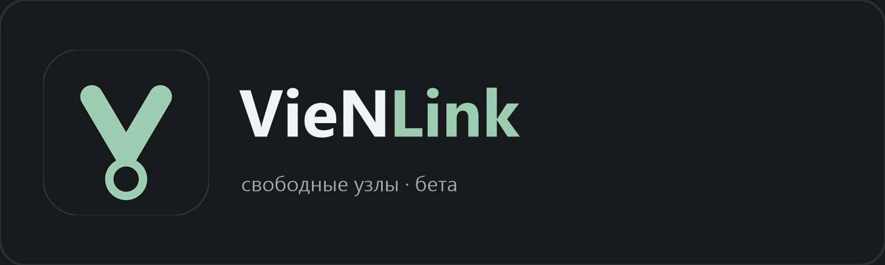
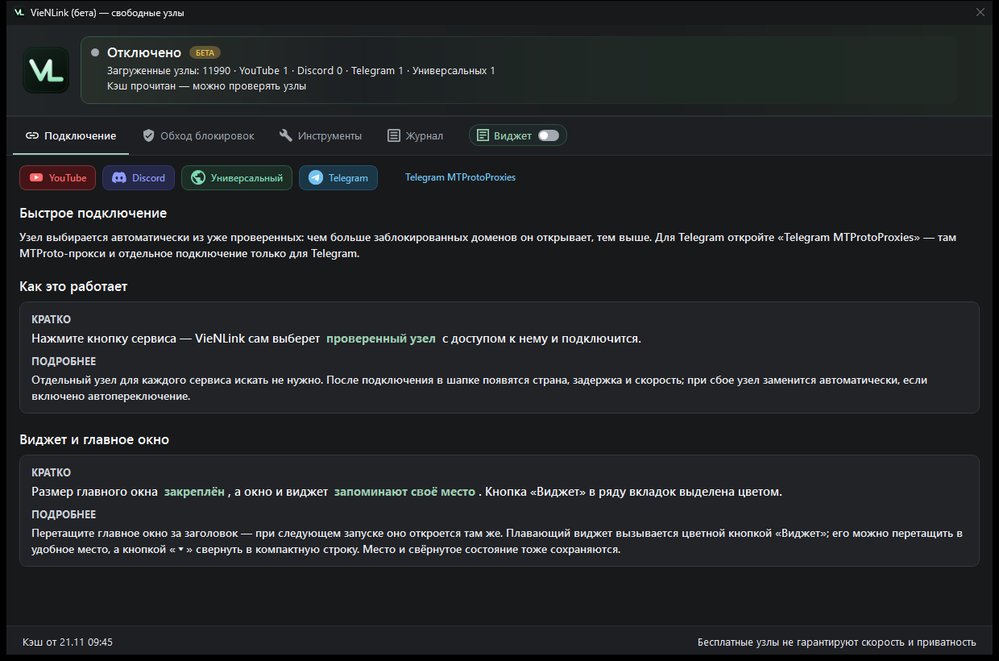

# VieNLink (бета)




[](https://github.com/VieNchikkk/VieNLink/releases)
[](LICENSE)

> **Статус: бета-версия.** Основные режимы проверены, но возможны сбои и изменения
> интерфейса. Для постоянной работы надёжнее своя подписка или свой сервер.

Клиент прокси для **Windows и Android**: собирает публичные узлы VLESS / VMess / Trojan /
Shadowsocks / Hysteria2 из открытых списков и подписок, проверяет их через
[sing-box](https://github.com/SagerNet/sing-box) и в одно нажатие включает системный прокси
(Windows) или VPN-туннель (Android), чтобы открывались заблокированные сайты.

Приложение не продаёт и не раздаёт доступ: узлы берутся из открытых источников, которые
поддерживают другие люди. Работоспособность и безопасность этих узлов никто не гарантирует.



## Скачать

Готовые сборки — в [Releases](https://github.com/VieNchikkk/VieNLink/releases):

- **Windows:** `VieNLink-1.0.10-setup.exe` (установщик в профиль пользователя) или портативный
  `VieNLink-1.0.10-win-x64.zip`. .NET устанавливать не нужно.
- **Android (отдельный релиз):** [VieNLink-1.1.1-android.apk](https://github.com/VieNchikkk/VieNLink/releases/download/v1.1.1-android/VieNLink-1.1.1-android.apk)
  (Android 8.0+, arm64). Отдельной страницы в магазине нет — APK ставится вручную,
  с разрешением установки из этого источника.

**Прямые ссылки:** [Windows setup.exe](https://github.com/VieNchikkk/VieNLink/releases/download/v1.0.10-beta/VieNLink-1.0.10-setup.exe)
· [Windows ZIP](https://github.com/VieNchikkk/VieNLink/releases/download/v1.0.10-beta/VieNLink-1.0.10-win-x64.zip)
· [Android APK](https://github.com/VieNchikkk/VieNLink/releases/download/v1.1.1-android/VieNLink-1.1.1-android.apk)

Контрольные суммы — в `SHA256SUMS.txt` рядом с файлами релиза. Android-версия при запуске
сама проверяет GitHub: если там версия выше, APK скачивается и предлагается установка
(Android всегда просит подтвердить установку в системном окне).

## Возможности

- Источники: raw-списки GitHub, base64-подписки, публичные каналы Telegram (`https://t.me/s/имя`).
- Подписки как в обычных клиентах: вставьте ссылку от провайдера — формат определяется сам
  (base64-список, Xray/V2Ray JSON, sing-box JSON, Clash YAML). Сразу после вставки узлы
  загружаются и проверяются; остаток трафика из заголовка `subscription-userinfo` виден в таблице.
- Автообновление: при запуске устаревшие подписки (по умолчанию старше 6 часов) обновляются сами.
- Периодическое обновление: раз в 2 часа (настраивается) приложение само перечитывает списки,
  подтягивает новые узлы и проверяет часть из них.
- Автопоиск новых источников (по умолчанию раз в сутки): ищет на GitHub недавно обновлённые
  репозитории с конфигами и на публичных сайтах, проверяет их файлы и добавляет только те, что реально дали узлы
  (такие источники помечены ★). Кнопка «Найти новые источники» запускает поиск вручную.
- Свои источники: любую ссылку можно добавить вручную на вкладке «Источники».
- MTProto-прокси для Telegram: сбор идёт сам через RSS-зеркала каждые 10 минут, рабочие
  прокси проверяются каждые 10 минут, нерабочие — изредка, удаляются через 24 часа.
  Кнопка «Открыть в Telegram» передаёт выбранный прокси мессенджеру; ручная проверка осталась.
- Проверка задержки через сам sing-box (Clash API), а не «на глаз»: измеряется время ответа
  проверочного адреса через конкретный узел.
- Подключение с подстраховкой: если выбранный узел не открывает сайт, приложение пробует
  следующие по скорости и сообщает, через какой узел всё заработало.
- Системный прокси Windows (WinINET): браузер и другие приложения, уважающие настройки системы,
  сразу ходят через прокси. Прежние настройки сохраняются и восстанавливаются при отключении.
- Список исключений: домены вроде `*.deepseek.com` и локальная сеть идут напрямую, чтобы не рвать
  связь с рабочими сервисами.
- Кэш узлов и задержек: при следующем запуске список и результаты проверки уже на месте.
- Главная кнопка «Подключить / Отключиться» в шапке окна, а в трее — быстрый выбор из лучших узлов.
- Скорость и суммарный трафик сессии в шапке (Clash API `traffic`), страна и IP выхода после подключения.
- Замер скорости узла (около 1 МБ через узел): задержка не показывает пропускную способность,
  а для видео выбирается самый быстрый проверенный узел.
- Автозапуск при входе в Windows, kill switch (не выпускать трафик напрямую при падении ядра),
  проверка и обновление ядра sing-box, снятие loopback-изоляции для приложений Магазина.
- Быстрые наборы доменов на вкладке «Туннель»: YouTube, Telegram, Discord, Instagram, Facebook, X.
- Плавающий виджет обхода: кнопки сервисов и обходов, перетаскивание, сворачивание
  и режим «поверх всех окон» (отключается закрепом в виджете или галочкой в «Общих»).
- Тёмная и светлая темы, значок в трее, журнал.

## Быстрый старт

1. Запустить `VieNLink.exe` (ядро sing-box скачается при первом подключении, ~33 МБ).
2. «Обновить списки» — приложение соберёт узлы из включённых источников.
3. Вкладка «Узлы» → «Непроверенные»: включите «Только маскированные» и нажмите
   «Партия 500» или «Все узлы». Рабочие узлы появятся в подвкладке «Рабочие».
4. В подвкладке «Рабочие» выберите узел и нажмите «Подключить» (если ничего не выбрано —
   приложение возьмёт лучший проверенный). То же делает кнопка «Подключить» в шапке окна —
   она работает с первого экрана, без перехода в «Инструменты».

Отключение — кнопкой «Отключиться» в шапке или рядом с «Подключить». Настройки прокси Windows
возвращаются в исходное состояние. Если окно закрыто, приложение остаётся в трее.

### Своя подписка

Вкладка «Источники» → вставьте ссылку подписки в поле адреса → «Добавить». Узлы появятся сразу,
остаток трафика — в колонке «Трафик». Обновить одну подписку: выделить её и нажать
«Обновить выбранный».

### Своя (платная) подписка

Вкладка «Источники» → поле адреса → «Добавить». Галочка **«Это моя подписка (платная)»** включена
по умолчанию, поэтому подписка попадает в отдельную группу **«Мои подписки»**, а всё остальное —
в «Публичные источники».

- Узлы личной подписки помечаются ★ в колонке «Источник».
- На вкладке «Узлы» есть фильтр «Только мои».
- При подключении узлы из «Моих подписок» пробуются первыми, даже если публичный узел быстрее:
  платный узел обычно стабильнее.
- Уже добавленный источник можно перевести в личные галочкой в колонке «Моя».

Ссылку на подписку берут в кабинете провайдера или в самом клиенте (Happ → подписка → «Поделиться»
/ «Скопировать ссылку»). Поддерживается и формат `happ://add/…` — вставляйте как есть.

Можно добавить и **одну ссылку на сервер** (`vless://`, `vmess://`, `trojan://`, `ss://`, `hysteria2://`) —
например, скопированную из Happ: она попадёт в «Мои подписки» как отдельный узел.

Если подписка возвращает только заглушки («Приложение не поддерживается», адреса `0.0.0.0:1`),
значит провайдер отдаёт узлы лишь своему клиенту (так делает, например, часть Happ-подписок).
Приложение покажет это в колонке «Статус». Что делать: запросить у провайдера универсальную
подписку (v2ray/xray) либо добавить ссылки на нужные серверы вручную.

### Telegram MTProtoProxies

Открывается вкладкой «Telegram MTProtoProxies» рядом с кнопками сервисов. Кнопка Telegram
в этом ряду — быстрое подключение через лучший узел с доступом к Telegram.

1. Убедитесь, что нужные каналы включены на вкладке «Источники» (например, `@MTProtoProxies`).
2. Сбор идёт автоматически через публичные RSS-зеркала каждые 10 минут; t.me не нужен.
3. Рабочие прокси проверяются каждые 10 минут, нерабочие — изредка; через 24 часа они удаляются.
4. «Проверить соединение» запускает ручную проверку, а «Открыть в Telegram» передаёт прокси мессенджеру.

Такие прокси работают только внутри Telegram: sing-box не умеет MTProto, поэтому браузер
через них не пойдёт.

## Android (бета)

Android-клиент (`VieNLink.Android`, `com.vienlink.app`) повторяет основные возможности
Windows-версии без MAUI: VPN-туннель через `VpnService` и `libbox` (sing-box), проверка узлов
в отдельном процессе `:probe`, экраны «Подключение / Обход / Инструменты / Журнал / Общие»,
виджет и плитка, split-tunnel по приложениям, MTProto для Telegram и TUN-обход (бета).

1. Скачайте [VieNLink-1.1.1-android.apk](https://github.com/VieNchikkk/VieNLink/releases/download/v1.1.1-android/VieNLink-1.1.1-android.apk)
   и откройте файл на телефоне. Android-версия публикуется отдельным релизом
   `v1.1.1-android`, независимо от Windows-релиза `v1.0.10-beta`.
2. Разрешите установку из выбранного источника (Android спросит один раз).
3. В приложении нажмите «Проверить узлы», затем кнопку нужного сервиса — VPN поднимется
   на проверенном узле.

**Обновления.** При каждом запуске приложение сверяет свою версию с GitHub Releases
(не чаще раза в 6 часов; в фоне — раз в сутки). Если на GitHub версия выше, APK скачивается
сам, проверяется по SHA-256 и предлагается установка поверх текущей. Настройки, источники
и кэш узлов сохраняются. Кнопка «Проверить обновление» в «Общих» и «О программе» запускает
проверку вручную. Android не позволяет ставить APK совсем без подтверждения: последний шаг —
системное окно «Установить».

Сборка APK для релиза:

```powershell
powershell -File build\publish-android.ps1
```

Скрипт использует долговременный ключ из `%LOCALAPPDATA%\VieNLink\signing` (создаёт его при
первом запуске) и кладёт в `release\` подписанный APK и файл `.apk.sha256`. Храните этот ключ:
следующие версии должны быть подписаны им же, иначе Android не установит обновление поверх.

Версия для Windows публикуется отдельно: [VieNLink 1.0.10 (бета)](https://github.com/VieNchikkk/VieNLink/releases/tag/v1.0.10-beta).

## Сколько узлов живых

В открытых списках обычно 1–3 % рабочих узлов, и они быстро умирают. Поэтому:

- проверяйте пачками: «Партия 500» идёт по 500 узлам, «Все узлы» — по всем с прогрессом,
  операцию можно прервать кнопкой «Отмена»; уже проверенные результаты сохраняются;
- обновляйте списки перед использованием — вчерашние узлы часто уже мертвы;
- если ни один узел не открыл сайт, добавьте свою подписку или источник с проверенными узлами.

## Скорость, трафик и защита от утечек

- **Замер скорости** — кнопка «Скорость» на вкладке «Узлы»: скачивает около 1 МБ через выбранный
  узел (или 10 лучших рабочих) и показывает Мбит/с. Задержка пропускную способность не показывает:
  узел с 300 мс на Hysteria2 может быть в десять раз быстрее узла с 80 мс на WS·TLS. Для «Видео
  YouTube» выбирается самый быстрый замеренный узел.
- **Статистика** — в шапке видно скорость ↓/↑ и объём за сессию, а также страну и IP выхода:
  так сразу понятно, куда выпускает случайный бесплатный сервер.
- **Kill switch** («Инструменты → Настройки») — если ядро упало, системный прокси остаётся
  на закрытом локальном порту: сайты перестанут открываться, но трафик не уйдёт напрямую.
  Вернуть интернет — кнопкой «Отключиться».
- **Автозапуск с Windows** и **проверка/обновление ядра** — на вкладке «Общие».
- **Приложения Microsoft Store** не видят прокси на `127.0.0.1` из-за изоляции loopback.
  Кнопка «Разрешить локальный прокси приложениям Магазина» (нужны права администратора)
  снимает это ограничение через `CheckNetIsolation`.

## Безопасность

Владелец узла видит, какие сайты вы посещаете, и может подменять незашифрованный трафик.
HTTPS защищает содержимое, но не скрывает факт посещения и имя сайта (SNI).

- не входите через бесплатные узлы в банки, почту и рабочие аккаунты;
- не устанавливайте рядом «ускорители», которые просят отключить антивирус;
- для постоянной работы лучше свой сервер (VPS) или платная подписка.

## Туннелирование и правила

Вкладка «Подключение» → «Туннель»:

- **Системный прокси Windows** — по умолчанию. Работает без прав администратора, покрывает браузеры
  и приложения, уважающие настройки системы.
- **TUN** — перехватывает трафик всех программ через виртуальный адаптер `VieNLink`.
  Нужны права администратора: приложение само предложит перезапуск с повышением (UAC).
  При первом запуске скачивает `wintun.dll` (~750 КБ) и кладёт рядом с `sing-box.exe`.
  В TUN системный прокси Windows не включается.

«Что проксировать»:

- **Всё через узел** — обычный режим.
- **Только сайты из списка** — через узел идут только перечисленные домены, остальное напрямую.
- **Всё, кроме сайтов из списка** — наоборот.

Список доменов — по одному в строке: `youtube.com` покрывает и сам домен, и поддомены
(`www.youtube.com`, `i.ytimg.com` нужно добавлять отдельно).

**Только для приложений из списка** — правило по процессам: `chrome.exe`, `Telegram.exe`
(можно вставлять полный путь, он сократится). Пустой список приложений = все приложения.

Правила работают в обоих режимах: в TUN домены берутся из TLS SNI и заголовка Host,
в режиме системного прокси — из самого запроса. Приложения, которые не уважают системный прокси,
в этом режиме не перехватываются вообще; для них нужен TUN.

## Обход DPI без прокси-узла

Два независимых режима — оба можно включать отдельно:

- **«Свой обход DPI»** — собственный движок на WinDivert (без winws.exe): режет TLS ClientHello
  на TCP-сегменты, меняет порядок или подмешивает фейковый ClientHello с безобидным SNI,
  а для QUIC отправляет поддельный Initial. Нужны права администратора; есть автоподбор стратегий.
  Рабочая стратегия — «Фейк + multidisorder, TTL 128/64» (страница YouTube и Discord открываются).
  Десинк применяется только к целевым доменам, остальные сайты идут напрямую.
  Видео YouTube на этом провайдере блокируется по IP (как и через zapret) — для видео нужен узел.
  Есть блокировка QUIC (UDP/443), чтобы видео шло по TCP.
  При подключении к узлу или включении zapret останавливается.
- **«TUN-обход»** — без прокси-узла и без WinDivert: sing-box поднимает TUN `VieNLink-Bypass`,
  TCP идёт в локальный SOCKS5-форвардер VieNLink, который открывает прямой канал и режет
  TLS ClientHello. Нужны права администратора и `wintun.dll`; QUIC блокируется, чтобы браузер
  перешёл на TCP. Работает по IPv4; IPv6 пока идёт напрямую. Трафик самого VieNLink.exe идёт
  напрямую, поэтому форвардер не зацикливается. На некоторых провайдерах Cloudflare
  открывается, а YouTube/t.me блокируются по IP — для них нужен узел или zapret.
- **«Обход запрет»** — проверенный zapret. Работает так же, но запускает внешний `winws.exe`.

Если узел уже подключён и нужно только ослабить DPI на рукопожатии, включите в «Настройках»
**«Быстрый обход DPI (TLS-фрагментация)»** — `tls.fragment` внутри sing-box, без WinDivert
и без прав администратора. Он действует только на трафик через узел.

## Проверка узлов

Проверка узлов идёт по двум адресам: **YouTube** (`https://www.youtube.com/`) и **Telegram** (`https://t.me/`).
В таблице узлов есть колонки «YouTube» и «Telegram»: `✓` — открылось, `—` — нет, `?` — ещё не проверялся.

- Узел, который открыл хотя бы один адрес, попадает на подвкладку **«Рабочие»**.
- Узел, который не открыл **ни один** из адресов, **сразу удаляется** из списка и кэша:
  нерабочие узлы не копятся, хранилища под них нет.
- Если при проверке не открылся ни один узел и при этом недоступен прямой интернет,
  приложение откатывает результаты: значит проблема в сети или ядре, а не в узлах.

## Где хранятся данные

`%LOCALAPPDATA%\VieNLink`:

- `settings.json` — настройки;
- `sources.dat` — список источников, зашифрованный DPAPI (ссылки подписок содержат токены);
- `nodes.json` — кэш узлов, задержек и скоростей;
- `core\sing-box.exe` — ядро; `core\version.txt` — установленная версия;
- `runtime\sing-box-config.json` — текущий конфиг ядра (удаляется при отключении и выходе);
- `logs\vienlink-*.log` — журнал.

Старый открытый `sources.json` читается при первом запуске и заменяется зашифрованным. Файл
`sources.dat` привязан к учётной записи Windows: на другом компьютере он не расшифруется,
источники придётся добавить заново (это защита токенов подписок).

При первом запуске VieNLink данные прежних названий переносятся автоматически:
`%LOCALAPPDATA%\DomVPN` (версии 1.0.x) и `%LOCALAPPDATA%\MyrrProxy` (самое первое имя) →
`%LOCALAPPDATA%\VieNLink`. Настройки, источники, кэш узлов и скачанное ядро сохраняются.

## Как это устроено

`sing-box` запускается отдельным процессом с локальным mixed-портом (HTTP + SOCKS5) и Clash API.
Переключение узла — PUT в Clash API, измерение задержки — GET `/proxies/{tag}/delay`.
Системный прокси задаётся в `HKCU\Software\Microsoft\Windows\CurrentVersion\Internet Settings`
и применяется через `InternetSetOption`.

В TUN-режиме sing-box создаёт виртуальный адаптер (`wintun.dll`) и забирает маршруты;
переключение узлов и проверка задержек остаются прежними. TUN требует запуска от администратора.
Без TUN игры и лаунчеры, игнорирующие системный прокси, не перехватываются.

## Сборка

```
dotnet build VieNLink.slnx
dotnet run --project VieNLink.SelfTest -- parsers
dotnet run --project VieNLink.SelfTest -- liveness 60
powershell -File build\publish-release.ps1
```

Режим подписи: если задан `-PfxPath` или `-Thumbprint`, exe подписывается им.
Иначе берётся отпечаток из `build\signing.thumbprint` (если сертификат есть в
`Cert:\CurrentUser\My`). Это удобно для повторных релизов на этой машине.

Релизный скрипт собирает self-contained один exe в `release\`. Если в
`%LOCALAPPDATA%\VieNLink\core\sing-box.exe` уже есть ядро, оно кладётся рядом с exe
в папку `core`, и приложение работает без скачивания.

## Версии и обновления

- Текущие версии: Windows — **1.0.10-beta**, Android — **1.1.1**; сборки —
  в [Releases](https://github.com/VieNchikkk/VieNLink/releases).
- В Windows-релизе лежат `setup.exe`, портативный ZIP и `SHA256SUMS.txt`; в Android-релизе —
  APK и файл `.apk.sha256`.
- Что изменилось: [CHANGELOG.md](CHANGELOG.md).
- Правила версий, схема данных и порядок выпуска: [docs/VERSIONING.md](docs/VERSIONING.md).
- Настройки, источники и кэш переживают обновление; папки `DomVPN` и `MyrrProxy`
  переносятся автоматически.

## Участие и обратная связь

- Как собрать и что проверить перед pull request — [CONTRIBUTING.md](CONTRIBUTING.md).
- Уязвимости и приватность — [SECURITY.md](SECURITY.md).
- Что изменилось между версиями — [CHANGELOG.md](CHANGELOG.md).
- Версии и совместимость данных — [docs/VERSIONING.md](docs/VERSIONING.md).
- Условия использования — [LICENSE](LICENSE).

## Лицензия

Проект распространяется по лицензии [GPL-3.0](LICENSE): можно использовать, изменять
и распространять код и сборки при условии, что производные работы тоже публикуются
под GPL-3.0 и с сохранением исходного кода.

Сторонние компоненты — по своим лицензиям: sing-box (GPL-3.0), zapret (MIT),
WinDivert (LGPL-3.0), wintun (лицензия Wintun), `cygwin1.dll` (LGPL-3.0+).
Полный перечень и тексты лицензий — в [THIRD-PARTY-NOTICES.md](THIRD-PARTY-NOTICES.md).


